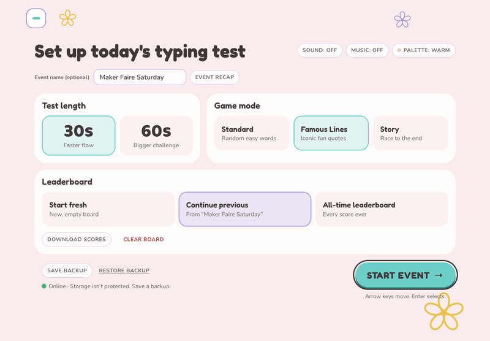
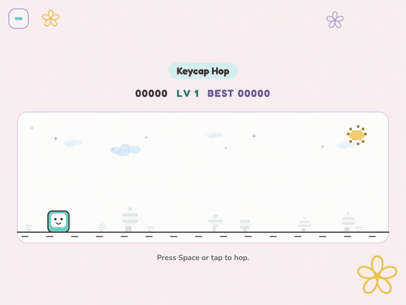
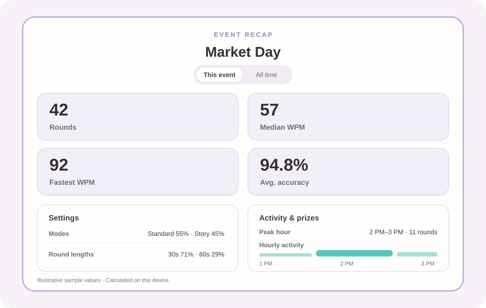
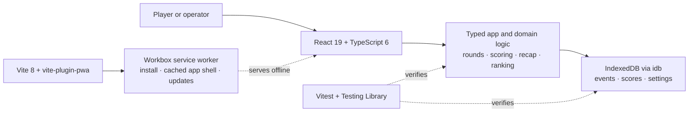

# clickclackchallenge

[](https://github.com/heykatie/clickclackchallenge/actions/workflows/checks.yml)

**A playful, local-first typing competition for shared screens.** Set a round, type against the clock, and see how you rank. The app installs as a web app, keeps scores on the device, and continues to work offline after its first load.

[**Try the live demo**](https://clickclackchallenge.vercel.app/) · [Product requirements](docs/prd.md) · [Technical plan](docs/technical_plan.md)

<p>
  
  
  
  
  
</p>

## See it in action

These recordings show the core experience. The settings and typing clips predate the latest recap screen; the recap preview below reflects the current interface.

<p align="center"></p>
<p align="center"><strong>Choose settings, start a round, and follow live typing stats.</strong></p>

<p align="center"></p>
<p align="center"><strong>Keycap Hop:</strong> optional runner gameplay, shown after the Easter egg opens.</p>

### Event recap

Operators can review this event or all-time totals, including round count, median and fastest WPM, accuracy, mode and round-length mix, activity by hour, and Plinko wins. The recap is calculated on-device and works offline.

<p align="center"></p>

The preview uses illustrative sample values. Names, typed text, and individual score rows are not included in recap totals.

## What you can do

| Goal | How the app handles it |
| --- | --- |
| Start a challenge | Pick a 30- or 60-second round and Standard, Famous Lines, or Story mode; no passage packs or account setup. |
| Follow the round | Timing starts on the first valid character; live WPM, time, and accuracy update as you type. |
| Save and compare scores | Review results, save a name, and see the leaderboard; event and all-time boards stay on the device. |
| Keep going offline | Install the app from HTTPS to use its cached version; normal scoring and recap need no network. |
| Explore a bonus game | Open Keycap Hop, a separate runner that does not affect contest scores or leaderboards. |

## Tech stack and architecture

This is a client-side React application with a deliberately local-first design: the browser runs the typing experience and calculations, while IndexedDB stores event data. Vite builds the static app, and the PWA service worker caches the app shell for offline launches. The core round, scoring, leaderboard, and recap paths do not depend on a server.



| Layer | Technology | How it is used |
| --- | --- | --- |
| UI and application logic | React 19, TypeScript 6 | Typed screens, event state transitions, keyboard controls, and reusable UI behavior. |
| Build and delivery | Vite 8, vite-plugin-pwa, Workbox | Static production build, installable web app, service-worker caching, and update flow. |
| On-device data | IndexedDB through `idb` | Persist event settings and scores without an account or required application server. |
| Testing | Vitest, Testing Library, jsdom, fake-indexeddb | Exercise scoring, state flows, persistence, screen behavior, and IndexedDB-backed paths. |
| Code quality | oxlint | Fast static checks alongside TypeScript's project build. |
| Optional analysis boundary | Vercel serverless route, Cloudflare Workers AI | A separately tested aggregate-only endpoint is retained for future analysis; the current recap UI does not call it. |

### Engineering details

- **State and domain logic:** setup, ready, typing, results, and leaderboard transitions are represented explicitly; scoring, ranking, recap totals, and game simulation live in testable modules.
- **Offline data path:** event setup, scores, leaderboard ranking, and recap calculations use browser storage. Network access is not required for the main experience after the app shell has been cached.
- **PWA update behavior:** Workbox precaches the built app, while updates are surfaced through the app's update flow so a new version does not interrupt an active round.
- **Test strategy:** Vitest and Testing Library cover deterministic logic and screen behavior; `fake-indexeddb` exercises persistence paths without a real browser database.
- **Optional AI boundary:** the existing route is separately tested and accepts aggregate statistics only. The current recap is deterministic and does not call that route.
- **Game isolation:** Keycap Hop's physics, obstacles, difficulty, and power-ups are separate from contest scoring and covered by deterministic tests.

## Run locally

Node.js 22 is required (`.nvmrc`).

```bash
nvm use
npm install
npm run dev
```

The development server skips service-worker registration. To inspect the production build and its install/offline behavior:

```bash
npm run build
npm run preview
```

## Checks

| Command | What it checks |
| --- | --- |
| `npm test` | Vitest suite for scoring, persistence, event flows, and game behavior |
| `npm run build` | TypeScript project checks and production Vite build |
| `npm run lint` | oxlint static checks |

## Project docs

- [Product requirements](docs/prd.md) — contest behavior, persistence, offline support, and acceptance criteria.
- [Technical plan](docs/technical_plan.md) — state flow, storage, service worker, optional analysis boundary, and test map.
- [Design system](docs/design_system.md) — visual tokens, typography, and interface copy.
- [Wireframes](docs/wireframes.md) — screen layouts and references.

## License

This public repository has no license file. Please ask before reusing its code or assets.
